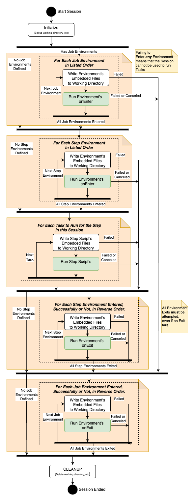

# How Jobs Are Run

Before reading this we recommend diving into [How Jobs Are Constructed](How-Jobs-Are-Constructed).

## Sessions

Open Job Description's Tasks are run within the context of a **Session**. A **Session** is an ephemeral runtime
environment on a Worker Host created to run a set of Tasks from the same Job, and is destroyed when the Worker Host is
done running Tasks for that Job. The **Session** provides a way for you to customize the environment that your Tasks
run within, such as defining a shared set of environment variables or starting a container to run Tasks. Allowing
multiple tasks to execute within the same **Session** **Environment** also allows for costly set up and tear down operations
to be used for multiple Tasks, resulting in more efficient job execution. This additionally allows for operations like
installing software or downloading files to the host.

A temporary **Working Directory** is created on the Worker Host for each **Session**, and deleted once all the Tasks
within that session have completed running, any **Environments** exited, and the **Session** terminated. The
**Working Directory** is available as scratch space for the Tasks running within the **Session**, which enables things
like sharing data between Tasks.

A Job and/or Step can define zero or more **Environments** that must be entered in a defined order at the start of
a **Session** prior to running any Tasks, and exited in the reverse order prior to terminating the **Session**. An
**Environment** defines **Actions**, command-lines with arguments, to run when it is entered or exited, and may also
define a set of environment variable values that become available in all subsequent **Actions** run in the **Session**
until the **Environment** is exited.

A render management system can also attach **Environments** to a Job from Environment Templates, such as a queue's Conda
**Environment**. A **Session** enters those first, in the order they are attached, and then the Job's own
**Environments**, so the Job's **Environments** can use what the attached ones set up.

Once the **Environments** have been created and entered for a **Session**, a series of Tasks are run within that
**Session** and the **Environments**. Tasks from any Step in a Job can run within the same **Session** provided that
the set of **Environments** that are required to run those Tasks are identical. With the ENV_PARAMS extension, Steps
can differ in which **Environments** their **Sessions** enter, and Steps that share a **Session** must also use the
same **Environment** parameter values (see [Environment Parameters](#environment-parameters)). If the parameter space
of a Step includes a task parameter with type `CHUNK[INT]` (part of the TASK_CHUNKING extension), then the **Session**
runs Chunks for that Step instead of individual Tasks. A Chunk is a set of Tasks with all of the Task parameter
values identical except for the chunked Task parameter. It takes values from an integer range expression
like "1-3" or 1-3,5,7" depending on whether the chunks are constrained to be contiguous or not.

If exactly one Environment in the session stack defines the wrap hooks (`onWrapEnvEnter`, `onWrapTaskRun`,
`onWrapEnvExit`, part of the WRAP_ACTIONS extension introduced in
[RFC 0008](https://github.com/OpenJobDescription/openjd-specifications/blob/mainline/rfcs/0008-environment-wrap-actions.md)),
the lifecycle actions of inner Environments and tasks
are intercepted: an inner Environment's `onEnter` is replaced by the wrapping Environment's
`onWrapEnvEnter`, a task's `onRun` is replaced by the wrapping Environment's `onWrapTaskRun`, and an inner
Environment's `onExit` is replaced by the wrapping Environment's `onWrapEnvExit`. The wrapping Environment's
own `onEnter` and `onExit` are never wrapped; they always run normally. A wrap hook runs only in place
of an action the inner Environment defines: if an inner Environment defines no `onExit` (or defines no
script at all), there is nothing to replace and the corresponding wrap hook does not run for it. If more
than one Environment
in the session stack defines any wrap hook, the session is invalid and the scheduler must reject it
before entering any Environment. If an Environment defines any wrap hook, it must define all three.

A wrap hook is treated as the action it replaces. A failed `onWrapEnvEnter` is an inner `onEnter`
failure, a failed `onWrapTaskRun` is a task `onRun` failure, and a failed `onWrapEnvExit` is an inner
`onExit` failure; the **Session** handles each failure exactly as it would in the unwrapped case. Wrap
scripts must propagate the wrapped process's exit status as their own.

Wrap hooks extend the **Session**'s cleanup guarantee symmetrically: if `onWrapEnvEnter` starts for an
inner Environment, that inner Environment's `onWrapEnvExit` must run, and the wrapping Environment's own
`onExit` must run on top of that. Resources allocated by the wrapping Environment's `onEnter` (for
example, a container) must remain available until every `onWrapEnvExit` returns.

The wrap hook's own cancelation method governs how the wrap script is canceled. The wrapped action's
cancelation semantics are surfaced to the wrap script via the `WrappedAction.Cancelation.Mode` and
`WrappedAction.Cancelation.NotifyPeriodInSeconds` template variables, so the wrap script may honor the
inner action's cancelation semantics when it propagates the termination signal — for example, allowing
a graceful notification period equal to `WrappedAction.Cancelation.NotifyPeriodInSeconds` before
terminating when the wrapped action requested `NOTIFY_THEN_TERMINATE`. When the wrap script receives a
termination signal, it must cause the wrapped process to receive a termination signal within the
cancelation grace period; after the grace period the wrap script receives SIGKILL, which cannot be
trapped.

When the EXPR extension is used, format strings evaluated on the Worker Host support the full
[expression language](2026-02-Expression-Language) including arithmetic, conditionals, function calls,
path manipulation, and script embedding functions like `repr_sh()` for safe shell quoting.

All failures and cancellations in a **Session** are terminal for the **Session**, as the system generally does not know
what state a failure or cancellation leaves the **Session** in. Think of a Task failure which inadvertently terminates
the container that was set up in an **Environment** for the Tasks to run
within. A failed Task will result in a failed **Session**, which will subsequently exit all **Environments** that the
**Session** entered or attempted to enter, and then be terminated itself.

The following diagram provides an overview of the steps taken to run a Session.



## Environment Parameters

With the ENV_PARAMS extension, introduced in
[RFC 0010](https://github.com/OpenJobDescription/openjd-specifications/blob/mainline/rfcs/0010-environment-parameters.md),
each Step can configure the **Environments** that its Tasks run in. Think of a Job whose first Step decodes a video with
ffmpeg and whose next Step solves the camera motion with COLMAP. Both Steps can get their software from the same Conda
**Environment**, but each needs different packages from it.

An **Environment** declares the parameters a Step may set, and reads their values as `{{Env.Param.<name>}}`. A Step
asks for an **Environment** with an `environment:` entry in its `dependencies`, and gives values for the parameters it
wants to set:

```yaml
steps:
  - name: SolveSfM
    dependencies:
      - environment: Conda
        parameters:
          Packages: "colmap=3.11"
```

Any parameter the Step leaves out takes its default, which can come from a Job Parameter. The entry can name one of
the Job's own Job Environments, or an **Environment** that the render management system attaches from an Environment
Template. An entry with `required: false` lets the Job run where that **Environment** is not attached, so one Job can
work with a Conda **Environment**, a Docker **Environment**, or neither. It also lets the Job run where the
**Environment** is attached but declares no parameters, as a Conda **Environment** written before ENV_PARAMS does. The
entry's values are then ignored, and implementations should warn. Such a Conda **Environment** installs what the Job
Parameters say, for the whole Job, as before.

With this extension, a **Session** need not enter every **Environment** of the Job. An **Environment**'s `activation`
decides which **Sessions** enter it:

* `BY_DEFAULT`, the default in a template that lists ENV_PARAMS: every **Session**, except those of a Step that declines
  the **Environment** with an entry whose `enableIf` is false, and those of a Step for which the **Environment**'s own
  `enableIf` is false. A Conda **Environment** can use its `enableIf` to skip the Steps that have no packages to
  install.
* `ALWAYS`: every **Session**. Use it for an **Environment** that every **Session** must enter, such as one that sets up
  licensing or auditing. A Job in which some Step declines it, or its `enableIf` is false for some Step, is rejected.
* `ON_REQUEST`: only the **Sessions** of the Steps that ask for it, less any for which its `enableIf` is false. Other
  **Sessions** never enter it.

An **Environment** from a template that does not list ENV_PARAMS, such as one written before the extension, is entered
by every **Session**, as an `ALWAYS` one is. A Step's entry for it whose `enableIf` is false has no effect, so a Job
cannot leave out an **Environment** that a render management system attached for licensing or auditing before it
adopted ENV_PARAMS.

The **Environments** a **Session** does enter keep the order they have in the Job.

Several **Environments** can provide the same thing in different ways, such as Conda, Docker, Rez, and Singularity. Give
them the same `exclusiveGroup`, and each Step's **Sessions** enter only the first of them, in the Job's order, that is
enabled for that Step. Attached **Environments** come first, in the order they were attached. A Job Template then has
one `environment:` entry for each kind it can use, and the system that attaches the **Environments** decides which one
each Step gets. [Environment Name Conventions](Environment-Name-Conventions) lists the names that such **Environments**
and the Job Templates that use them should share.

A parameter without a default must be supplied by every Step that the **Environment** applies to: every Step for an
`ALWAYS` one, every Step that does not decline a `BY_DEFAULT` one, and every Step that requests an `ON_REQUEST` one.
This holds even for a Step for which the **Environment**'s own `enableIf` turns out to be false, so a missing value is a
mistake in the Step. Checking the Job Template reports it for the Job's own **Environments** wherever the Step's
`environment:` entries are known then, and creating the Job reports it in every case, attached **Environments**
included. The `enableIf` is then evaluated with the Step's actual values. If it reads a value that cannot be worked out,
such as `"many"` for an INT parameter, it is not evaluated, and the Job is rejected.

All of these values and decisions are worked out once, when the Job is created, from the Job Parameters and the
templates. So before anything runs, the render management system knows which **Environments** each Step's
**Sessions** enter and with which values. [Template Schemas §3.2](2023-09-Template-Schemas#32-stepdependency) and
[§4](2023-09-Template-Schemas#4-environment) give the exact rules, including when a submission is rejected.

When a **Session** enters an **Environment**, it keeps the same parameter values until it exits that **Environment**.
The **Environment**'s `onEnter`, its `onExit`, and what it provides to every Task run while it is entered, such as its
`variables` and wrap hooks, all use the same values. A Task's own script still cannot read them. This
adds a condition to sharing a **Session** between Steps. A **Session** can run Tasks of a Step only when the
**Environments** it has entered, and not yet exited, are exactly the ones that Step's **Sessions** enter, and the Step's
values for each of them are equal to the values the **Session** entered it with
([Template Schemas §3.2.2](2023-09-Template-Schemas#322-effective-environment-parameter-values) states this rule and
defines equality). Two values are equal when they have the same type and the same text, the text
`{{Env.RawParam.<name>}}` gives each value before path mapping. So an INT parameter given as `1` by one Step and as
`"1"` by another has equal values, while a FLOAT given as `"3.10"` by one Step and as `"3.1"` by another does not,
because a FLOAT keeps the text it was written with.

The render management system does not need to know in advance which Steps a **Session** will serve. It can add a
Step's Tasks to a **Session** that is already running whenever these conditions hold. To move on to a Step that needs
different **Environments** or values, a **Session** can exit **Environments**, in the reverse of the order it entered
them, and enter others, or enter the same **Environment** again with the other Step's values. The render management
system can also use another **Session** instead.

Because the values are known when the Job is created, a render management system can group a Job's **Sessions** by
them, and can prefer a Worker Host that recently entered an **Environment** with the same values, such as one that has
a matching Conda environment or container image cached. In the video pipeline above, each Step's **Sessions** then
install or pull only the software that Step needs.

Path mapping rules are applied on the Worker Host to PATH and LIST[PATH] parameter values, as they are to PATH Job
Parameters. A Step's own script cannot read `Env.Param.*`. A Step that needs a value in both places can bind it with
`let` and use the binding in its `environment:` entry and its script.

## Session Environment Variables

The following environment variables are automatically set for all **Actions** running within a **Session**:

| **Environment Variable** | **Value** | **Corresponding Template Variable** |
|---|---|---|
| `OPENJD_SESSION_WORKING_DIR` | The absolute path to the **Session**'s **Working Directory**. | `Session.WorkingDirectory` |

These environment variables are provided for nested subprocesses that cannot access Open Job Description template
variables directly. Unlike template variables, environment variables are automatically inherited by child processes.

As a rule of thumb, OpenJD favors template variables over environment variables. When jobs use template substitution, tools can look at the template and accurately determine data flow to understand and modify the template. When jobs use environment variables, there is no reliable way to do this. We use the Tooling parseable design tenet to guide choices like this.

The `OPENJD_SESSION_WORKING_DIR` environment variable is an example of this consideration in practice. Unlike other template variables, the session working directory is already accessible without using a variable; session actions start their CWD set to the session working directory. This is the same value as the {{Session.WorkingDirectory}} template variable, so exposing it as an environment variable does not reduce the tooling parseability of Job Templates. Any future environment variable additions should be intentionally considered with the design tenets in mind rather than assumed to follow this precedent.


## Host Requirements

Open Job Description provides a mechanism for a Step to impose requirements that must be satisfied for Tasks from the
Step to be scheduled. Each requirement corresponds to an attribute of a Worker Host or render manager that must be
satisfied to allow the Step to be scheduled to the Worker Host. Some examples of concrete attributes include
processor architecture (x86_64, arm64, etc.), the number of CPU cores, the amount of system memory, or available
floating licenses for an application. We also allow for user-defined requirements whose meaning is specified by the
user; a `“SoftwareConfig”` requirement whose values could be `“Option1”` or `“Option2”`, for example.

There are two types of requirements: amount and attribute.

Amount requirements are the mechanism for defining a quantity of something that the Worker Host or render manager needs
for a Step to run. They represent quantifiable things that must be reserved — vCPUs, memory, licenses, etc. They are
always a non-negative floating point value, and a Step can require a certain amount of that capability, “at least 4 CPU
cores” for example. Further, a quantity of each amount required are allocated to a **Session** while that **Session**
is running on a Worker Host. A Step requiring “at least 4 CPU cores” might result in a **Session** with 4 CPU cores
allocated to it being created on a Worker Host. Those cores are reserved for that **Session** while it is running on
the Worker Host. For scheduling purposes, this effectively reduces the number of available cores on the Worker Host by
4 for the duration of the **Session**. Logically fitting multiple **Sessions** into a single Worker Host is the key
mechanism by which system resources can be optimized by a render management system.

Attribute requirements are the mechanism for specifying an attribute a Worker Host must have for a Step to be scheduled
to it. They are always defined on a Worker Host as a set of strings. A Step can assert that it requires a Worker Host to
have specific value(s) of the attribute for it to be scheduled to the Worker Host. For example, a Step may require its
Tasks run on a host that is in the `"linux"` or `"macos"` family of operating systems, or that a host has the shared
filesystems `"movie-A"`, `"shared-assets"`, and `"software"` all mounted.

With the ENV_PARAMS extension, an **Environment** can have host requirements too. A Docker **Environment**, for
example, can require a Linux host. A **Session** that enters the **Environment** is placed only on a Worker Host that
meets both the Step's requirements and the **Environment**'s, and the amounts are reserved for the **Session** as a
Step's are. Requirements from the Step and its **Environments** all apply together, so a Step that needs one GPU and
an **Environment** that needs one GPU reserve one GPU, not two. An **Environment**'s requirements can read its
parameters and are worked out for each Step, so a Docker **Environment** can require a GPU only for the Steps that ask
it to use one. A Step whose **Sessions** do not enter the **Environment** is not affected by its requirements. If the
requirements contradict each other, such as a minimum amount above a maximum, the Job is rejected when it is created.
[Template Schemas §3.3.3](2023-09-Template-Schemas#333-combined-host-requirements) gives the rules for combining them.

## Stdout/Stderr Messages

Open Job Description defines some special messages that can be emitted on stdout or stderr as a single line by an
**Action** when it is running within a **Session**. The application that is running the **Action** may intercept these
messages to convey information about the **Action** to the render management system. These special lines contain one of:

* `openjd_progress: <number>` where `<number>` is a percentile between 0 and 100 that indicates what the progress of
  the **Action** is.
* `openjd_status: <message>` where `<message>` is any string. This provides a human-readable status message indicating
  what the **Action** is doing. For example, a status message of `“loading assets”` or `"rendering"` or
  `"dohickying the whatsits."`
* `openjd_fail: <message>` where `<message>` is any string. This provides a human-readable message that indicates why
  an **Action** has failed.
* `openjd_env: <var>=<value>` where `<var>` is the string name of an environment variable, and `<value>` is a string. This
  can only be emitted by the **Action** for entering an **Environment**. It defines the value of an environment variable for
  all subsequent **Action**s in the **Session** until the defining **Environment** is exited.
* `openjd_redacted_env: <var>=<value>` has identical behavior to openjd_env except `<value>` shall be redacted by the
  application running the action in the emitted stdout line and in any future lines. Requires the REDACTED_ENV_VARS
  extension, however supporting applications must honor the redaction even when the extension is not specified.
* `openjd_unset_env: <var>` where `<var>` is the string name of an environment variable. This can only be emitted by the
  **Action** for entering an **Environment**. This unsets the given environment variable for all subsequent **Action**s
  in the **Session** until the **Environment** that emitted it is exited.

When the WRAP_ACTIONS extension is in use, schedulers must scan the stdout of the wrap script (`onWrapEnvEnter`,
`onWrapTaskRun`, or `onWrapEnvExit`) for these macros, not the stdout of the wrapped process. Wrap scripts must
forward the wrapped process's stdout and stderr verbatim — without buffering, filtering, or transformation —
which causes macros emitted by the wrapped process to be recognized identically to macros emitted by the wrap
script itself. A wrap script may also emit these macros directly. The `WrappedAction.Environment` template
variable includes every `openjd_env`-defined variable emitted by any earlier **Action** in the same
**Session**, regardless of whether that **Action** ran normally or via a wrap hook.

## Path Mapping

An artists' workstation's filesystem may not match that of the Worker Host that will be running a Task. Shared
filesystems may be mounted in different locations, or the workstation and Worker Host may be different operating systems.
Open Job Description provides mechanisms for running Tasks to discover and correct for these differences in environment.

An application running an Open Job Description **Session** may communicate **Path Mapping Rules** to running subprocesses
via a JSON file in the **Session**'s **Working Directory**. This allows the render management system, which knows how and
from what environment a Job was submitted, as well as the configuration of the Worker Host, to accurately control path
mapping within the **Session**, by providing a set of programmatically generated **Path Mapping Rules**.

The format for the path mapping rules is:

```yaml
{
   "version": "pathmapping-1.0",
   # The path_mapping_rules list will be empty if there are no path mapping rules defined
   "path_mapping_rules": [
      {
         # The path format that the submitting operating system uses
         "source_path_format": "POSIX" | "WINDOWS",
         # The filepath prefix to map (e.g. "/home/user" or "c:\Users\user").
         # It must be an absolute path in source_path_format (see below).
         "source_path": <string>,
         # The location on the worker host where the path can be found
         # (e.g. "/mnt/shared/user" or "z:\")
         "destination_path": <string>
      },
      ...
   ]
}
```

The location of this file, and whether there are path mapping rules defined, are available as value references for
use in [Format Strings](How-Jobs-Are-Constructed#format-strings) within a Job Template. The value references available are:

**`@extension EXPR` — URI source paths**: When the EXPR extension is enabled,
`source_path_format` also accepts `"URI"` for mapping URI prefixes (e.g. `s3://bucket/assets`)
to local filesystem paths. A URI `source_path` must start with `<scheme>://`, where the scheme has at
least two characters. URI matching uses string prefix comparison on path boundaries, preserving the exact URI
content without normalization: the scheme and authority compare case-insensitively, and the path
compares exactly, with empty segments kept.

1. `Session.HasPathMappingRules` -- Has the string value `true` or `false`.
    * `true` — means that the path mapping JSON contains path mapping rules.
    * `false` — means that the path mapping JSON contains no path mapping rules.
2. `Session.PathMappingRulesFile` -- Has a string value providing the absolute file path to the path mapping rules JSON file.
   The JSON object in this file is allowed to be the empty object if there are no path mapping rules defined.

### Applying Path Mapping Rules within a Job Template

The **PATH** type Job and Task parameters provide an integration point in the Job Template for the path mapping system.
If a collection of path mapping rules are provided to a **Session**, then those rules are applied to all **PATH** type
parameters when they are resolved in Format Strings. A rule applies to a path when the path is the rule's source path or a path under it, comparing whole path
components. The rest of the path, after the source path, is appended to the destination path.

1. Each `source_path` must be an absolute path in its `source_path_format`: for `POSIX`, a path that starts
   with `/`; for `WINDOWS`, a path that starts with a drive and separator (`C:\`) or a UNC share
   (`\\server\share`). A relative source path would only ever match relative paths, whose meaning depends on a
   working directory that the rule cannot know, so a set of rules that contains one must be rejected.
2. `POSIX` and `WINDOWS` paths are compared component by component. For `POSIX`, components are
   separated by `/`. For `WINDOWS`,
   components are separated by `\` or `/`, a drive or UNC share must match as a whole, and components
   compare case-insensitively the way Windows compares file names. Empty components (from repeated or
   trailing separators) and `.` components are ignored; `..` components are not collapsed.
3. When more than one rule applies to a path, the rule whose source path has the most names is used. Each
   component after the start of the path counts as one name. The start counts as no names for the `POSIX`
   root `/`, one for a drive (`C:`) or a URI's scheme and authority, and two for a UNC share (its server and
   share), so `/srv/share` and `\\srv\share` both have two. If a `POSIX` rule and a `WINDOWS` rule with the
   same number of names both apply (only a path such as `//srv/share/x` can match both), the `WINDOWS` rule is
   used. Rules whose source paths have the same components name the same location (for example `/mnt/p` and
   `/mnt/p/`), and the rule that appears last in the list is used.
