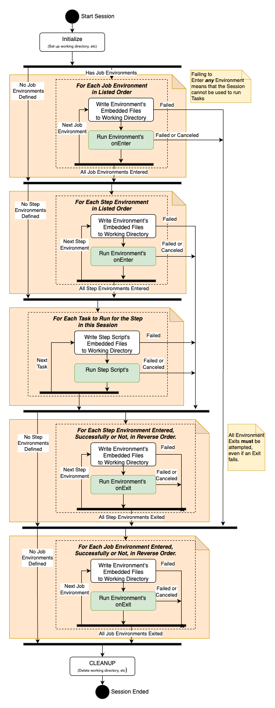

# How Jobs Are Run

Before reading this we recommend diving into [How Jobs Are Constructed](How-Jobs-Are-Constructed).

## Sessions

Open Job Description's Tasks are run within the context of a **Session**. A **Session** is an ephemeral runtime
environment on a Worker Host created to run a set of Tasks from the same Job, and is destroyed when the Worker Host is
done running Tasks for that Job. The **Session** provides a way for you to customize the environment that your Tasks
run within, such as defining a shared set of environment variables or starting a container to run Tasks. Allowing
multiple tasks to execute within the same **Session** **Environment** also allows for costly set up and tear down operations
to be used for multiple Tasks, resulting in more efficient job execution. This additionally allows for operations like
installing software or downloading files to the host.

A temporary **Working Directory** is created on the Worker Host for each **Session**, and deleted once all the Tasks
within that session have completed running, any **Environments** exited, and the **Session** terminated. The
**Working Directory** is available as scratch space for the Tasks running within the **Session**, which enables things
like sharing data between Tasks.

A Job and/or Step can define zero or more **Environments** that must be entered in a defined order at the start of
a **Session** prior to running any Tasks, and exited in the reverse order prior to terminating the **Session**. An
**Environment** defines **Actions**, command-lines with arguments, to run when it is entered or exited, and may also
define a set of environment variable values that become available in all subsequent **Actions** run in the **Session**
until the **Environment** is exited.

Once the **Environments** have been created and entered for a **Session**, a series of Tasks are run within that
**Session** and the **Environments**. Tasks from any Step in a Job can run within the same **Session** provided that
the set of **Environments** that are required to run those Tasks are identical. If the parameter space of a Step
includes a task parameter with type `CHUNK[INT]` (part of the TASK_CHUNKING extension), then the **Session**
runs Chunks for that Step instead of individual Tasks. A Chunk is a set of Tasks with all of the Task parameter
values identical except for the chunked Task parameter. It takes values from an integer range expression
like "1-3" or 1-3,5,7" depending on whether the chunks are constrained to be contiguous or not.

If exactly one Environment in the session stack defines the wrap hooks (`onWrapEnvEnter`, `onWrapTaskRun`,
`onWrapEnvExit`, part of the WRAP_ACTIONS extension introduced in
[RFC 0008](https://github.com/OpenJobDescription/openjd-specifications/blob/mainline/rfcs/0008-environment-wrap-actions.md)),
the lifecycle actions of inner Environments and tasks
are intercepted: an inner Environment's `onEnter` is replaced by the wrapping Environment's
`onWrapEnvEnter`, a task's `onRun` is replaced by the wrapping Environment's `onWrapTaskRun`, and an inner
Environment's `onExit` is replaced by the wrapping Environment's `onWrapEnvExit`. The wrapping Environment's
own `onEnter` and `onExit` are never wrapped; they always run normally. A wrap hook runs only in place
of an action the inner Environment defines: if an inner Environment defines no `onExit` (or defines no
script at all), there is nothing to replace and the corresponding wrap hook does not run for it. If more
than one Environment
in the session stack defines any wrap hook, the session is invalid and the scheduler must reject it
before entering any Environment. If an Environment defines any wrap hook, it must define all three; with the SERVICE
extension, the hooks it must define follow from its `runScope` instead (see
[Section 4.3](2023-09-Template-Schemas#43-environmentactions)).

A wrap hook is treated as the action it replaces. A failed `onWrapEnvEnter` is an inner `onEnter`
failure, a failed `onWrapTaskRun` is a task `onRun` failure, and a failed `onWrapEnvExit` is an inner
`onExit` failure; the **Session** handles each failure exactly as it would in the unwrapped case. Wrap
scripts must propagate the wrapped process's exit status as their own.

Wrap hooks extend the **Session**'s cleanup guarantee symmetrically: if `onWrapEnvEnter` starts for an
inner Environment, that inner Environment's `onWrapEnvExit` must run, and the wrapping Environment's own
`onExit` must run on top of that. Resources allocated by the wrapping Environment's `onEnter` (for
example, a container) must remain available until every `onWrapEnvExit` returns.

The wrap hook's own cancelation method governs how the wrap script is canceled. The wrapped action's
cancelation semantics are surfaced to the wrap script via the `WrappedAction.Cancelation.Mode` and
`WrappedAction.Cancelation.NotifyPeriodInSeconds` template variables, so the wrap script may honor the
inner action's cancelation semantics when it propagates the termination signal — for example, allowing
a graceful notification period equal to `WrappedAction.Cancelation.NotifyPeriodInSeconds` before
terminating when the wrapped action requested `NOTIFY_THEN_TERMINATE`. When the wrap script receives a
termination signal, it must cause the wrapped process to receive a termination signal within the
cancelation grace period; after the grace period the wrap script receives SIGKILL, which cannot be
trapped.

When the EXPR extension is used, format strings evaluated on the Worker Host support the full
[expression language](2026-02-Expression-Language) including arithmetic, conditionals, function calls,
path manipulation, and script embedding functions like `repr_sh()` for safe shell quoting.

All failures and cancellations in a **Session** are terminal for the **Session**, as the system generally does not know
what state a failure or cancellation leaves the **Session** in. Think of a Task failure which inadvertently terminates
the container that was set up in an **Environment** for the Tasks to run
within. A failed Task will result in a failed **Session**, which will subsequently exit all **Environments** that the
**Session** entered or attempted to enter, and then be terminated itself.

The following diagram provides an overview of the steps taken to run a Session.



## Services

When the SERVICE extension is in use (introduced in
[RFC 0009](https://github.com/OpenJobDescription/openjd-specifications/blob/mainline/rfcs/0009-service.md)), a Job can
additionally declare **Services**. A **Service** is a long-lived process that the scheduler starts *before* scheduling
any Task in its scope, keeps running for the lifetime of its scope, and stops once the scope no longer needs it. The
**scope** of a **Service** is the set of Steps whose Tasks depend on it, declared in the template's `dependencies`
lists (see [Section 9.1](2023-09-Template-Schemas#91-service-scope)). A **Service** publishes one or more named ports; the scheduler allocates a concrete
address and port on the **Service**'s host and makes them available to every entity that depends on it through the
`Service.*` format-string scope, so that a Task on any Worker Host knows where to connect.

Unlike an **Environment**, a **Service** is not tied to the host that runs Tasks. It runs in a **Session** of its own,
the **Service Session**, on a **Service host** chosen by the scheduler subject to the **Service**'s host requirements,
and it outlives every **Session** that runs Tasks against it. A **Service Session** enters the Job's **Environments**,
in the same order a **Session** for a Task would, around the **Service**'s own actions, so a **Service** is provisioned
by the same Conda, Rez, or container **Environments** as the Tasks; a **Service** belongs to no Step and enters no
Step's **Environments**. Later **Environments** take precedence over earlier ones for environment variables, and the
**Service**'s own `variables` over all of them. Which kinds of **Session** an **Environment** is entered in is declared
by its `runScope`: by default every kind, and only an **Environment** whose `runScope` includes `SERVICE` is entered
in a **Service Session**. An **Environment** that
configures Tasks to use a **Service** lists `service: <name>` in its `dependencies`, which is what lets it reference
`Service.*`, and is entered in Task **Sessions** only; that is its default `runScope`, and an explicit `runScope` on it
must exclude `SERVICE`. Under the WRAP_ACTIONS extension, a
wrapping **Environment** whose `runScope` includes `SERVICE` wraps the **Service**'s `onEnter`, `onRun`,
`onHealthCheck`, and `onExit` with its `onWrapServiceEnter`, `onWrapServiceRun`, `onWrapServiceHealthCheck`, and
`onWrapServiceExit` hooks, exactly as `onWrapTaskRun` wraps a Task's `onRun`, and wraps the inner **Environments** of
the **Service Session** with `onWrapEnvEnter` and `onWrapEnvExit` as in any **Session**. Placement is up to the
scheduler: a distributed render manager might dedicate a host to a **Service**, while a single-host runner starts it
alongside the Tasks on loopback. Whatever the placement, `connectAddress` and `port`, over the port's `protocol`, must
reach the service process from every host in the scope. A **Service Session** is a **Session** in every other respect
too: it has its own working directory, and it receives [Path Mapping Rules](#path-mapping) for the **Service host** the
same way a **Session** running Tasks does, so `PATH` Job Parameters in a **Service**'s actions are mapped for the host
the **Service** runs on.

### Service lifecycle

One launch of a **Service**'s `onRun` action is an **instance**; a **Service** has one instance at a time, and a
relaunch creates a new one. A **Service** is always in one of four states: **UNREADY** (no instance is **READY**: none has been launched, the
current one has not yet passed a health-check probe, or the previous one failed and a relaunch is pending), **READY**
(the current instance has passed a health-check probe, has not since failed `failureThreshold` consecutive probes, and
has not exited), **UNHEALTHY** (the current instance has failed `failureThreshold` consecutive health-check probes and
is being stopped; a transient state in which, for every other purpose including Task scheduling, the **Service** is not
**READY**), or **FAILED** (the **Service** will not be relaunched and its scope has failed). A **Service** is
**UNREADY** from Job creation. Starting a **Service** means opening a **Service Session** on a host that satisfies the
**Service**'s host requirements and, within it, entering the Job's **Environments** whose `runScope` includes
`SERVICE`, running
`onEnter` if defined, launching `onRun`, and probing it with its health check. When a probe succeeds, the **Service** is
**READY**, and the health check keeps probing it for as long as `onRun` runs: `failureThreshold` consecutive failed
probes after **READY** make the instance **UNHEALTHY**, which is an instance failure (see
[Service failure and restart](#service-failure-and-restart)).

A scheduler must satisfy the following constraints; how it satisfies them is its own concern.

1. All of a **Service**'s ports are allocated, and its `bindAddress` and `connectAddress` values determined, before any
   **Action** of its **Service Session** runs.
2. No **Action** of a **Service Session** (including the `onEnter` of an **Environment** it enters) begins until every
   entry in the **Service**'s `dependencies` is satisfied: every listed Step has completed and every listed **Service**
   is **READY**. **Services** neither of which depends on the other, directly or transitively, may start concurrently.
3. No Task of a Step is scheduled until every **Service** whose scope includes that Step is **READY**. Once they are,
   Tasks are scheduled exactly as described above, with no change to how **Sessions** are formed.
4. A **Service** is stopped before any **Service** it depends on; **Services** neither of which depends on the other
   may be stopped concurrently.
5. A **Service** has at most one live **Service Session** at a time, and at most one running `onRun` within it. Before
   `onRun` is launched again in the same **Session**, the previous `onRun` process must have exited, on its own or
   because the scheduler canceled it.
6. A **Service Session** ends when the **Service**'s scope completes (no Step in the scope has a Task that could still
   run, whether because every Task completed or because the scope failed or was canceled), when the **Service** is
   relocated, or when the **Session** fails to start. A **Service** whose scope completes must have its **Session**
   ended whatever its state, including **UNREADY**, **UNHEALTHY**, and **FAILED**, so that partial state is cleaned up.
7. Before a **Service Session** ends: any running **Action** is canceled with its own cancelation method; `onExit` runs
   if it is defined and any **Action** of the **Service** has run; and every **Environment** entered is exited in
   reverse order, as at the end of any **Session**. Then the working directory is deleted and the host's allocated
   amounts and ports are released. Nothing orders a **Step** outside the scope after this; whether a **Step** that
   depends on a **Step** in the scope, but not on the **Service**, can see files the **Service** wrote is
   implementation-defined.
8. A **Service** that is started again after its **Session** has ended begins a new **Service Session**: new host
   selection, new ports, new working directory, **Environments** re-entered, `onEnter` re-run.
9. A scheduler may start a **Service** at any time consistent with these constraints, including lazily, when it is
   first prepared to schedule a Task in the **Service**'s scope, and may decline to start a **Service** whose scope
   will schedule no Task. Once started, a **Service** is kept **READY** until its scope completes or it fails, with one
   exception. A scheduler may **suspend** a **Service** while no Task in its scope is running or can be scheduled. A
   suspension is not a failure: the **Service Session** ends as constraint 7 requires, the **Service** becomes
   **UNREADY**, no restart attempt is consumed, completed Tasks keep their results, and the **Service** is started
   again in a new **Service Session** (constraint 8) when the scheduler is next prepared to schedule a Task in its
   scope. A **Service** must not be suspended unless its `completedTasks` is `KEEP`, nor while any **Service** that
   lists it has a **Service Session**; a **Service** that other **Services** depend on is therefore suspended only
   after they are, which requires them to be `KEEP` **Services** too.
10. A health-check probe in flight when `onRun` exits is canceled, with its cancelation method when it is an
    **Action**, and its result is discarded, whether the instance was **READY** or not. No probe result observed after
    `onRun` has exited makes an instance **READY** or keeps it **READY**; the instance has failed.

### Service failure and restart

Two kinds of failure lead to the restart decision. An **instance failure** occurs when `onRun` exits, with any exit
status, while the **Service**'s scope still has work (a Task that has not completed, or that could still run), other
than because the scheduler canceled it; when `readinessTimeoutSeconds` elapses before the instance is **READY**; when
the instance becomes **UNHEALTHY**, having failed `failureThreshold` consecutive health-check probes after **READY**; or
when the scheduler loses the **Service host** (step 6 below).
An exit observed after the scope has completed is not a failure, whether or not the scheduler's cancelation had yet
reached the process. A **start failure** occurs when a **Service Session** fails before `onRun` is launched: a requested
port cannot be allocated on the chosen host, an **Environment**'s `onEnter` fails, or the **Service**'s `onEnter` exits
non-zero or times out.

On either failure the **Service** becomes **UNREADY** (an **UNHEALTHY** instance, once its `onRun` has exited) and the
scheduler takes steps 1–4; steps 5–8 govern the outcomes those steps can produce.

1. If the **Service**'s `completedTasks` is `RERUN`, the scheduler cancels every running Task in the scope; each is
   returned to the queue to run again once the **Service** is **READY**, and this is not counted as a Task failure. If
   it is `KEEP`, running Tasks continue. A Task that needs the **Service** while it is not **READY**, or that holds the
   endpoint of a relocated instance, fails on its own and is retried under the ordinary Task retry rules, re-resolving
   `Service.*` when it runs again; a Task that no longer needs the **Service** completes normally.
2. If `onRun` is still running (the readiness-timeout and **UNHEALTHY** cases) the scheduler cancels it and waits for it
   to exit; constraint 5 above forbids a second `onRun` in the **Session** before then.
3. If the **Service**'s restart policy has attempts remaining, the scheduler relaunches the **Service**. If the policy's
   `completedTasks` is `RERUN`, every Task in the scope that had completed successfully is first returned to the queue;
   with `KEEP`, completed Tasks keep their results. After a start failure or host loss the relaunch must begin a new **Service Session**. After an
   instance failure on a host that is still available, it may relaunch `onRun` within the existing **Service Session**
   (same working directory, same ports, `onEnter` not re-run), preserving the state `onEnter` established; it should
   begin a new **Service Session**, which allocates new ports, when the failure may be a port conflict (`onRun` exited
   without ever becoming **READY**); or it may relocate (step 5).
4. If no attempts remain, the **Service** becomes **FAILED** and its scope fails: every Step in the scope fails, and
   with it the Job when the scope is every Step. The **Service Session** is then ended per constraint 6.
5. **Relocation.** Relaunching in a new **Service Session** on a different host is relocation. It counts as one
   relaunch, is governed by the same restart policy, and changes every `Service.<name>.*` value. When relocating away from a host that is still available, constraint 7 above applies to the
   old **Session** in full.
6. **Host loss.** A scheduler loses a **Service host** when it determines, by its own means, that the host is gone or
   unreachable. This is an instance failure. The scheduler does not wait for `onExit`, **Environment** exits, or
   working-directory cleanup there; it releases the host's allocations and proceeds to steps 1–4. If the host later
   reappears the scheduler should terminate any surviving service process and remove the working directory, but the
   **Service**'s state is unaffected.
7. **`RERUN` and Step dependencies.** `RERUN` returns the completed Tasks of every Step in the **Service**'s scope to
   the queue (step 3), so each of those Steps returns to a pending state; a Step that depends on a returned Step,
   directly or transitively, returns to pending as well, and Step dependencies are resolved again from scratch. A
   **Service** that had been stopped because its scope completed, and whose scope includes a returned Step, is started
   again, in a new **Service Session**, when that Step next becomes schedulable.
8. **Dependents of a relaunched Service.** When a **Service** begins a new **Service Session** (after a start failure,
   host loss, suspected port conflict, suspension, or relocation), every **Service** that lists it, directly or
   transitively, holds endpoint values that are no longer valid. The scheduler must stop each such dependent in the
   order of constraint 4 (dependents before the **Services** they list) and start each again in a new **Service
   Session** once every **Service** it lists is **READY**. This stop does not consume the dependent's restart attempts,
   and the dependent's `completedTasks` applies to its own scope exactly as for any instance that is stopped and started
   again (its Tasks that completed against the old instance are returned under `RERUN`, kept under `KEEP`). A relaunch
   within the same **Service Session** keeps the same ports and requires nothing of dependents. A dependent whose
   restart policy gives no `completedTasks` (permitted when its `maxAttempts` is 0) is stopped and started again as a
   `RERUN` **Service** here; one that wants its completed Tasks kept gives `completedTasks: KEEP` whatever its
   `maxAttempts`.

A Task failure never fails a **Service**.

### Services from Environment Templates

A scheduler may supply **Services** to every Job submitted through it by attaching Environment Templates that define a
`services:` list, in the same way it supplies **Environments** today. Such an **external Service** has its scope
computed over the combined Job by the same rules as one the Job Template declares, and is otherwise indistinguishable
from it: each Job that uses it gets its own instance, the Tasks in its scope are gated on its being **READY**, and its
restart policy governs them. An Environment Template may define both `services:` and an `environment:`; the
**Environment** lists the **Services** whose endpoints it reads, which puts every Step of the Job in their scope, and
may for example set environment variables that point Tasks at them. A Job Template that reads the endpoint itself
declares the **Service** and the ports it uses in `externalServices` (see
[Section 9.8](2023-09-Template-Schemas#98-servicerequirement)) and lists it in `dependencies` as it would an inline
**Service**; at submission the scheduler matches each requirement to exactly one attached **Service** of that name
declaring those ports with the same protocols, and rejects the submission otherwise. An attached **Service** that
nothing in the combined Job lists is never started.

## Session Environment Variables

The following environment variables are automatically set for all **Actions** running within a **Session**:

| **Environment Variable** | **Value** | **Corresponding Template Variable** |
|---|---|---|
| `OPENJD_SESSION_WORKING_DIR` | The absolute path to the **Session**'s **Working Directory**. | `Session.WorkingDirectory` |

These environment variables are provided for nested subprocesses that cannot access Open Job Description template
variables directly. Unlike template variables, environment variables are automatically inherited by child processes.

As a rule of thumb, OpenJD favors template variables over environment variables. When jobs use template substitution, tools can look at the template and accurately determine data flow to understand and modify the template. When jobs use environment variables, there is no reliable way to do this. We use the Tooling parseable design tenet to guide choices like this.

The `OPENJD_SESSION_WORKING_DIR` environment variable is an example of this consideration in practice. Unlike other template variables, the session working directory is already accessible without using a variable; session actions start their CWD set to the session working directory. This is the same value as the {{Session.WorkingDirectory}} template variable, so exposing it as an environment variable does not reduce the tooling parseability of Job Templates. Any future environment variable additions should be intentionally considered with the design tenets in mind rather than assumed to follow this precedent.


## Host Requirements

Open Job Description provides a mechanism for a Step to impose requirements that must be satisfied for Tasks from the
Step to be scheduled. Each requirement corresponds to an attribute of a Worker Host or render manager that must be
satisfied to allow the Step to be scheduled to the Worker Host. Some examples of concrete attributes include
processor architecture (x86_64, arm64, etc.), the number of CPU cores, the amount of system memory, or available
floating licenses for an application. We also allow for user-defined requirements whose meaning is specified by the
user; a `“SoftwareConfig”` requirement whose values could be `“Option1”` or `“Option2”`, for example.

There are two types of requirements: amount and attribute.

Amount requirements are the mechanism for defining a quantity of something that the Worker Host or render manager needs
for a Step to run. They represent quantifiable things that must be reserved — vCPUs, memory, licenses, etc. They are
always a non-negative floating point value, and a Step can require a certain amount of that capability, “at least 4 CPU
cores” for example. Further, a quantity of each amount required are allocated to a **Session** while that **Session**
is running on a Worker Host. A Step requiring “at least 4 CPU cores” might result in a **Session** with 4 CPU cores
allocated to it being created on a Worker Host. Those cores are reserved for that **Session** while it is running on
the Worker Host. For scheduling purposes, this effectively reduces the number of available cores on the Worker Host by
4 for the duration of the **Session**. Logically fitting multiple **Sessions** into a single Worker Host is the key
mechanism by which system resources can be optimized by a render management system.

Attribute requirements are the mechanism for specifying an attribute a Worker Host must have for a Step to be scheduled
to it. They are always defined on a Worker Host as a set of strings. A Step can assert that it requires a Worker Host to
have specific value(s) of the attribute for it to be scheduled to the Worker Host. For example, a Step may require its
Tasks run on a host that is in the `"linux"` or `"macos"` family of operating systems, or that a host has the shared
filesystems `"movie-A"`, `"shared-assets"`, and `"software"` all mounted.

## Stdout/Stderr Messages

Open Job Description defines some special messages that can be emitted on stdout or stderr as a single line by an
**Action** when it is running within a **Session**. The application that is running the **Action** may intercept these
messages to convey information about the **Action** to the render management system. These special lines contain one of:

* `openjd_progress: <number>` where `<number>` is a percentile between 0 and 100 that indicates what the progress of
  the **Action** is.
* `openjd_status: <message>` where `<message>` is any string. This provides a human-readable status message indicating
  what the **Action** is doing. For example, a status message of `“loading assets”` or `"rendering"` or
  `"dohickying the whatsits."`
* `openjd_fail: <message>` where `<message>` is any string. This provides a human-readable message that indicates why
  an **Action** has failed.
* `openjd_env: <var>=<value>` where `<var>` is the string name of an environment variable, and `<value>` is a string. This
  can only be emitted by the **Action** for entering an **Environment**. It defines the value of an environment variable for
  all subsequent **Action**s in the **Session** until the defining **Environment** is exited. With the SERVICE extension,
  it may also be emitted by a **Service**'s `onEnter` **Action**, in which case it defines the variable for that
  **Service**'s own subsequent **Action**s only.
* `openjd_redacted_env: <var>=<value>` has identical behavior to openjd_env except `<value>` shall be redacted by the
  application running the action in the emitted stdout line and in any future lines. Requires the REDACTED_ENV_VARS
  extension, however supporting applications must honor the redaction even when the extension is not specified.
* `openjd_unset_env: <var>` where `<var>` is the string name of an environment variable. This can only be emitted by the
  **Action** for entering an **Environment** (or, with the SERVICE extension, a **Service**'s `onEnter`). This unsets the
  given environment variable for all subsequent **Action**s in the **Session** until the **Environment** that emitted it
  is exited, or for the **Service**'s own subsequent **Action**s.
* `openjd_service_ready: <message>` where `<message>` is any string. Requires the SERVICE extension. This is interpreted
  only when emitted by the `onRun` **Action** of a **Service** whose health check type is `STDOUT`. Before the instance
  is **READY** it indicates that the service is accepting traffic on all of its declared ports, and makes the instance
  **READY**. After **READY** it is a heartbeat when the health check gives `healthIntervalSeconds`: the runtime arms a
  deadline `healthIntervalSeconds` after the later of **READY** and the most recent line, a line before the deadline
  re-arms it, a deadline that passes without a line is a failed probe that arms the next, and `failureThreshold`
  consecutive failed probes make the instance **UNHEALTHY**. When no `healthIntervalSeconds` is given, further lines
  have no additional effect. Emitting it from any
  other **Action** is ignored. When `onRun` is wrapped by `onWrapServiceRun`, the line is recognized on the wrap
  script's stdout, as for every `openjd_*` message under WRAP_ACTIONS.

In a **Service Session**, `openjd_status`, `openjd_progress`, and `openjd_fail` are honored from the **Service**'s
`onEnter`, `onRun`, and `onExit`, and not from `onHealthCheck`. `openjd_fail` supplies the reason reported when the
**Action** fails; the exit status decides whether it failed, and the message accompanies the start failure, instance
failure, or `onExit` failure (see [Service failure and restart](#service-failure-and-restart)) that the exit produces.
The environment variables defined for every **Session** in [Session Environment
Variables](#session-environment-variables), currently `OPENJD_SESSION_WORKING_DIR`, are set in every **Action** of a
**Service Session** with their usual meanings.

When the WRAP_ACTIONS extension is in use, schedulers must scan the stdout of the wrap script (`onWrapEnvEnter`,
`onWrapTaskRun`, `onWrapEnvExit`, and, with the `SERVICE` extension, the `onWrapService*` hooks) for these macros,
not the stdout of the wrapped process. Wrap scripts must forward the wrapped process's stdout and stderr verbatim —
without buffering, filtering, or transformation — which causes macros emitted by the wrapped process to be
recognized identically to macros emitted by the wrap script itself. A wrap script may also emit these macros
directly. The `WrappedAction.Environment` template variable includes every `openjd_env`-defined variable emitted by
any earlier **Action** in the same **Session**, regardless of whether that **Action** ran normally or via a wrap
hook.

## Path Mapping

An artists' workstation's filesystem may not match that of the Worker Host that will be running a Task. Shared
filesystems may be mounted in different locations, or the workstation and Worker Host may be different operating systems.
Open Job Description provides mechanisms for running Tasks to discover and correct for these differences in environment.

An application running an Open Job Description **Session** may communicate **Path Mapping Rules** to running subprocesses
via a JSON file in the **Session**'s **Working Directory**. This allows the render management system, which knows how and
from what environment a Job was submitted, as well as the configuration of the Worker Host, to accurately control path
mapping within the **Session**, by providing a set of programmatically generated **Path Mapping Rules**.

The format for the path mapping rules is:

```yaml
{
   "version": "pathmapping-1.0",
   # The path_mapping_rules list will be empty if there are no path mapping rules defined
   "path_mapping_rules": [
      {
         # The path format that the submitting operating system uses
         "source_path_format": "POSIX" | "WINDOWS",
         # The filepath prefix to map (e.g. "/home/user" or "c:\Users\user")
         "source_path": <string>,
         # The location on the worker host where the path can be found
         # (e.g. "/mnt/shared/user" or "z:\")
         "destination_path": <string>
      },
      ...
   ]
}
```

The location of this file, and whether there are path mapping rules defined, are available as value references for
use in [Format Strings](How-Jobs-Are-Constructed#format-strings) within a Job Template. The value references available are:

**`@extension EXPR` — URI source paths**: When the EXPR extension is enabled,
`source_path_format` also accepts `"URI"` for mapping URI prefixes (e.g. `s3://bucket/assets`)
to local filesystem paths. URI matching uses string prefix comparison on path boundaries,
preserving the exact URI content without normalization.

1. `Session.HasPathMappingRules` -- Has the string value `true` or `false`.
    * `true` — means that the path mapping JSON contains path mapping rules.
    * `false` — means that the path mapping JSON contains no path mapping rules.
2. `Session.PathMappingRulesFile` -- Has a string value providing the absolute file path to the path mapping rules JSON file.
   The JSON object in this file is allowed to be the empty object if there are no path mapping rules defined.

### Applying Path Mapping Rules within a Job Template

The **PATH** type Job and Task parameters provide an integration point in the Job Template for the path mapping system.
If a collection of path mapping rules are provided to a **Session**, then those rules are applied to all **PATH** type
parameters when they are resolved in Format Strings. The path mapping rules that are supplied are applied in order of
decreasing length of the source path, and processing stops for particular value once a rule matches.
